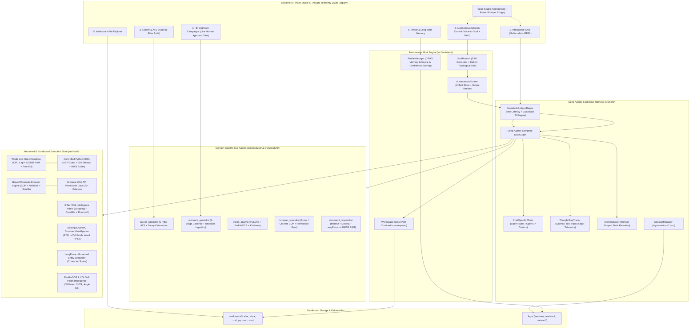

<div align="center">

# J.A.R.V.I.S.
### Autonomous Multi-Modal Agent Intelligence Platform

```text
                     ██╗ █████╗ ██████╗ ██╗   ██╗██╗███████╗
                     ██║██╔══██╗██╔══██╗██║   ██║██║██╔════╝
                     ██║███████║██████╔╝██║   ██║██║███████╗
                ██   ██║██╔══██║██╔══██╗╚██╗ ██╔╝██║╚════██║
                ╚█████╔╝██║  ██║██║  ██║ ╚████╔╝ ██║███████║
                 ╚════╝ ╚═╝  ╚═╝╚═╝  ╚═╝  ╚═══╝  ╚═╝╚══════╝
Joint Autonomous Real-time Vision & Intelligence System — CLI & Web Platform
```

[](https://www.python.org/)
[](https://streamlit.io/)
[](https://docs.langchain.com/oss/python/deepagents/overview)
[](https://github.com/langchain-ai/langgraph)
[](https://www.guardrailsai.com/)
[](https://github.com/SYSTRAN/faster-whisper)
[](https://github.com/browser-use/browser-use)
[](https://github.com/DS4SD/docling)
[](https://github.com/opendatalab/MinerU)
[](https://github.com/google/langextract)
[](https://github.com/D4Vinci/Scrapling)
[](https://github.com/PaddlePaddle/PaddleOCR)
[](https://github.com/ultralytics/ultralytics)
[](https://github.com/facebookresearch/faiss)
[](https://pytorch.org/)
[](LICENSE)

</div>

**J.A.R.V.I.S.** (Joint Autonomous Real-time Vision & Intelligence System) is an enterprise-grade autonomous AI super-intelligence platform and executive personal assistant. Engineered on **Deep Agents**, **LangGraph**, **Guardrails AI**, **Voice Studio (Faster-Whisper)**, **browser-use**, **Docling**, **MinerU**, **LangExtract**, **Scrapling**, and **PaddleOCR**, it empowers users by breaking down high-level human objectives into executable dependency DAGs, taking real-time voice commands, delegating tasks to domain-isolated specialist sub-agents, interacting with live web applications via Brave & Chrome DevTools, performing deep document intelligence with LaTeX formula extraction, executing SOTA scene text OCR with angle classification, enforcing kernel-level process sandboxing via Windows Job Objects, and generating real-world deliverables (Microsoft Excel workbooks, Word documents, Markdown briefings, and Python automation scripts) in a secure, sandboxed environment.

---

## System Architecture



---

## Architectural Pillars

J.A.R.V.I.S. is architected on seven foundational engineering pillars:

### 1. The 6 Deep Agents Pillars
1. **Planning**: Autonomous multi-step goal decomposition and Kahn's topological DAG dependency execution.
2. **Subagents**: Domain-isolated subagents (`career_specialist`, `outreach_specialist`, `vision_analyst`, `browser_specialist`, `document_researcher`).
3. **Context**: Sliding-window context compaction, token budgeting, and head/tail conversation turn preservation.
4. **Skills**: Modular skill registration, capability discovery, and dynamic ATS taxonomy matching.
5. **Filesystem**: Sandboxed workspace file operations with native `.xlsx`, `.docx`, `.md`, `.json`, `.csv` artifact generation.
6. **Tool Orchestration**: Multi-modal tool execution, sandbox isolation, and real-time `ThoughtStepTracer` telemetry.

### 2. The 5 LangGraph Pillars
1. **State**: Strongly-typed state schemas (`TypedDict`) and `add_messages` message accumulator reducers.
2. **Durability**: Fault-tolerant BSP Pregel execution loop with resilient fallback error recovery.
3. **Interrupts**: Human-in-the-loop pause and resumption triggers (`interrupt_on`) for high-stakes actions.
4. **Checkpoints**: Thread-scoped memory persistence and multi-turn state resumption via `MemorySaver`.
5. **Custom Workflows**: Declarative `StateGraph` node routing, START/END boundaries, and conditional branching.

### 3. Guardrails AI Deep Defense Engine
1. **Zero-Latency Deterministic Shield**: Regex-based instant interceptors blocking prompt injection patterns, prompt leaks, jailbreak vectors, and system override exploits.
2. **Dynamic PII & Secret Redaction**: Automatic masking of API tokens (`sk-`, `ghp_`, `xoxb-`), private keys, sensitive auth credentials, and personal email addresses.
3. **External Framework Integration**: Pluggable `GuardrailsBridge` integrating Guardrails AI validators (`detect_pii`, `toxic_language`, `sql_injection`) with native fallbacks.
4. **Dual-Gate Validation**: Enforces safety constraints on both ingress user queries and egress LLM generation before UI streaming.

### 4. Multi-Engine Voice Studio Bridge
1. **Voice-to-Goal Automation**: Speak complex mission directives naturally; audio is converted into structured DAG goals instantly without typing.
2. **Faster-Whisper Transcription Engine**: Local, GPU/CPU-accelerated speech-to-text with automatic sample rate normalization (16 kHz mono float32).
3. **Windows Speech API (SAPI) Fallback**: Zero-dependency OS-level speech recognition for instant, lightweight offline command dictation.
4. **Microphone Telemetry & Capture**: Direct audio stream recording with energy thresholding, silence trimming, and noise filtering.

### 5. 3-Tier Web Intelligence Matrix
1. **Tier 1 — Scrapling Adaptive Scraper**: Resilient, anti-bot-bypassing web scraping powered by Scrapling's adaptive DOM matching (`Adaptor` selector engine) for unstable or dynamic sites.
2. **Tier 2 — Crawl4AI Deep Markdown Crawler**: High-fidelity structured markdown extraction with automated noise filtering (cookie banners, scripts, ads, headers/footers).
3. **Tier 3 — Firecrawl Dynamic Web Mapper**: Fast recursive link discovery, sitemap generation, and site-wide content mapping for comprehensive domain exploration.

### 6. Hardware-Enforced Kernel Sandboxing (Win32 Job Objects)
1. **Windows Job Objects API**: Direct Win32 `kernel32` process containment enforcing hardware-level limits on child processes via `ctypes`.
2. **Resource Quotas**: Hard-capped process execution with **512 MB peak commit memory limit**, **25% CPU core execution limit**, and a maximum of 4 concurrent active processes.
3. **Process Tree Auto-Kill**: Enforces `JOB_OBJECT_LIMIT_KILL_ON_JOB_CLOSE`, ensuring that if a script hangs or times out, all child sub-processes and spawned trees are instantly killed at the OS level.
4. **AST Code Security Validator**: Strict pre-execution syntax validation rejecting forbidden modules (`os`, `subprocess`, `socket`, `shutil`, `ctypes`) and dangerous builtins before execution.

### 7. Brave Browser Stealth Agency & Granular Permission Gate
1. **Brave Browser Privacy Engine**: Native auto-detection of `brave.exe` for enhanced tracker blocking, ad neutralization, and anti-fingerprinting.
2. **Chrome DevTools Protocol (CDP)**: Low-level browser automation supporting CSS selector clicking, multi-field form submission, DOM inspection, and viewport scrolling.
3. **Granular Permission Gate**: 25+ browser and OS permission controls (Camera, Microphone, Geolocation, Notifications, Clipboard, MIDI, USB, Bluetooth) with strict origin auditing and zero-trust policies.

### 8. Omnichannel Messaging Gateway & Remote Control (Telegram Bot Bridge)
1. **Bidirectional Remote Control**: Full smartphone remote interaction with J.A.R.V.I.S. over Telegram Bot API using asynchronous `httpx` long-polling.
2. **Autonomous Voice Memo Execution**: Send voice notes from your mobile device; Faster-Whisper automatically downloads, normalizes, and transcribes directives for execution.
3. **Remote Mission Planning (`/goal`)**: Trigger complex DAG autonomous goal executions on your host system directly from Telegram with live task progress streaming.
4. **Automated Deliverable Dispatch**: Generated deliverable documents (`.xlsx`, `.docx`, `.md`) are automatically detected and uploaded straight to your Telegram chat upon mission completion.

### 9. Continuous Hands-Free Ambient Wake-Word Engine
1. **Acoustic Keyword Spotting**: Always-on ambient listener spotting `"Jarvis"` and `"Hey Jarvis"` acoustic keywords.
2. **Windows SAPI & Speech Recognition**: Zero-dependency OS-level continuous acoustic stream spotter utilizing PowerShell System.Speech without requiring heavy external models.
3. **Instant Speech Directive Capture**: Seamless transition from wake detection to directive speech recording and Faster-Whisper neural transcription.

### 10. SQLite WAL + FTS5 Full-Text Search Conversational Memory
1. **Sub-Millisecond Retrieval**: High-throughput SQLite database engine with Write-Ahead Logging (`WAL`) and `PRAGMA synchronous=NORMAL` for concurrent multi-thread read/write.
2. **FTS5 Virtual Full-Text Indexing**: Porter-stemmed unicode61 full-text search indexing across thousands of conversation turns.
3. **Rich Snippet Extraction**: Instant keyword query execution with highlighted snippet boundaries via `/search <query>` slash command in the CLI.

### 11. Closed-Loop Procedural Skill Synthesis (`agentskills.io`)
1. **Automated Skill Synthesis**: Successful multi-step autonomous goal executions are automatically analyzed and compiled into reusable skill bundles.
2. **Open Standard Formatting**: Generates `agentskills.io`-compliant `SKILL.md` documents complete with YAML frontmatter, tool requirements, and step-by-step instructions.
3. **Registry-Backed Reusability**: Centralized registry (`workspace/skills/registry.json`) allowing J.A.R.V.I.S. to reuse proven workflows on future goals.

---

## Core Product Capabilities

### 1. Autonomous Goal Planning & DAG Execution
- **Topological DAG Decomposition**: Decomposes high-level instructions into executable Directed Acyclic Graphs (DAGs) resolved via Kahn's algorithm with cycle fallback protection.
- **Artifact Store Pattern**: Subtasks receive outputs only from their declared upstream dependencies rather than concatenating full history, eliminating token bloat and context drift.
- **Semantic Output Verification**: After tool execution, the engine evaluates whether deliverables satisfy instruction requirements before proceeding, triggering targeted self-correction retries when outputs fall short.
- **Real-Time Telemetry**: Streams live step progress, execution latency, and intermediate artifacts in the **Autonomous Mission Control** dashboard.

### 2. Voice-to-Action Mission Control
- **Hands-Free Dictation**: Tap the microphone button in Mission Control or Intelligence Chat to speak your instructions.
- **Automatic Acoustic Preprocessing**: WAV normalization, background noise suppression, and automatic silence detection.
- **Direct Goal Dispatching**: Transcribed audio prompts automatically populate the goal planning harness and trigger DAG generation with a single click.

### 3. 3-Tier Web Intelligence Matrix
- **Tier 1 (Scrapling)**: Uses intelligent fuzzy element matching that survives website redesigns and changes to CSS classes or DOM hierarchy.
- **Tier 2 (Crawl4AI)**: Extracts clean, LLM-ready Markdown while retaining critical table structures and link anchors.
- **Tier 3 (Firecrawl)**: Automatically crawls and maps multi-page documentation hubs, directories, and corporate portals.

### 4. Smart HR Outreach & Cold Email Engine
- **Dynamic Variable Substitution**: Ingests recipient spreadsheets (CSV/Excel) and normalizes headers (`firstName`, `company`, `role`, `email`) for bulk personalization.
- **4-Stage Follow-Up Sequence Copilot**: Automatically generates structured multi-stage outreach cadences (Day 1 Pitch, Day 4 Value Add, Day 8 Soft Nudge, Day 14 Graceful Breakup).
- **Interactive Recruiter Previewer**: Renders live per-recipient email previews before campaign execution.
- **Mandatory Agent Simulation Gate**: Agent-invoked dispatches are strictly forced into simulated mode with Excel audit logs (`workspace/`); live SMTP delivery requires explicit human-in-the-loop confirmation in the UI.

### 5. Career Intelligence & 5-Pillar ATS Resume Engine
- **Normalized 5-Pillar Scoring**: Evaluates candidate resumes against target job descriptions across Keywords, Skills, Experience, Education, and Formatting, clamped strictly to $[0, 100]$.
- **Section-Aware Field Weighting**: Applies contextual multipliers for skills found in Experience (1.5x) and Projects (1.3x) over raw skills lists.
- **Missing Keyword Detection**: Categorizes missing terms into Critical (required), Important (preferred), and Optional with negation phrase awareness.
- **Heuristic Compensation Estimation**: Calculates transparent market salary bands ($\pm 15\%$) based on years of experience, education tier, and skill breadth.
- **Tailored Resume Generation**: Exports formatted, ATS-optimized Microsoft Word (`.docx`) and Markdown (`.md`) resumes directly to the workspace.

### 6. Workspace File Operations & Deliverable Generation
- **Path-Confined Deliverable Sandbox**: Confines all file operations strictly to the `workspace/` directory with path traversal protection against `..` and drive-letter injections.
- **Microsoft Excel Generator**: Synthesizes structured `.xlsx` workbooks with custom sheets and formatted columns from raw JSON tables.
- **Microsoft Word & Markdown Generator**: Generates formal reports, whitepapers, and briefings in `.docx` and `.md`.
- **Python Automation Generator**: Writes and inspects standalone Python automation scripts.

### 7. Universal Document Intelligence, Grounded Extraction & Data RAG
- **MinerU Scientific Document Intelligence**: High-precision PDF layout analysis, reading order reconstruction, complex cross-page table recognition, and LaTeX mathematical formula extraction (inline and display math expressions like `$E = mc^2$` and `$$\int ...$$`), purpose-built for academic, scientific, and technical papers.
- **Docling Document Intelligence**: Deep layout and structural parsing for PDF, Word (.docx), PowerPoint (.pptx), HTML, and Markdown, converting complex visual arrangements and tables into cleanly structured Markdown with resilient automatic fallback to native parsers (`pypdf`, `python-docx`, `pandas`).
- **Google LangExtract Grounded Information Extraction**: Extracts structured entities and key attributes from unstructured text with exact character-level source text grounding (`start_pos`, `end_pos`), schema constraints, and automatic generation of interactive HTML visualizer reports in `workspace/`.
- **Tabular Data Understanding**: Automatically extracts dataset schemas, dimensions, and statistical summaries (`df.describe()`).
- **MD5/SHA-256 Content Caching**: Computes composite hashes over file contents and names to eliminate redundant vector embeddings indexing.
- **Vector Retrieval**: Dense semantic similarity search powered by FAISS and `all-MiniLM-L6-v2` embeddings.

### 8. Computer Vision & Optical Intelligence
- **PaddleOCR SOTA Scene Text OCR**: State-of-the-art optical character recognition powered by DBNet++ text detection, SVTR recognition, and direction angle classification for high-precision extraction from fine print, receipts, labels, signage, and documents.
- **Tesseract OCR Fallback**: Resilient secondary OCR engine providing fail-safe printed and handwritten text recognition when primary models are unavailable.
- **YOLOv8 Object Detection**: Real-time object localization, counting, classification, and visual bounding box annotations rendered inline in chat.
- **Quality & Color Analytics**: Discrete Laplacian variance blur calculation, brightness, contrast, and K-Means dominant color extraction ($K=4$).

### 9. Controlled Python Execution & Visual Analytics
- **Hardware-Isolated Execution**: Commands are wrapped inside Windows Job Objects with 512MB RAM and 25% CPU core ceilings.
- **Controlled REPL Environment**: Executes calculations, statistical simulations, and data manipulation with blocked dangerous imports (`os`, `subprocess`, `socket`, `ctypes`, `shutil`), restricted builtins, a 30s timeout, and a 50KB output limit.
- **Inline Chart Buffer**: Intercepts generated **Matplotlib and Plotly figures** directly from memory and renders them inline in the UI stream.

### 10. Deep Web & Encyclopedic Research
- **DuckDuckGo Search**: Real-time web queries and news verification.
- **Wikipedia Tool**: Encyclopedic lookups and scientific summaries.
- **SSRF-Guarded Web Scraper**: Fetches full article content with URL scheme validation (`http`/`https`), private/internal IP blocking (`127.0.0.0/8`, `10.0.0.0/8`, `192.168.0.0/16`, `::1`), response size caps (500KB), and redirect limits.

### 11. Personal Profile & Long-Term Memory Lifecycle
- **Customized User Profile**: Configures your name, role, preferred output style, and custom executive directives.
- **Full Memory CRUD Lifecycle**: Full support for adding, updating by ID, deleting by ID, and platform-safe atomic clearing.
- **Confidence Scoring & Source Tracking**: Tracks memory reliability ($0.0 - 1.0$) and origin (`user_explicit`, `conversation`, `agent_inferred`), sorting top memories into system prompt context.
- **Multi-Session Chat**: Save, switch, and export session transcripts to Markdown (`.md`).

---

## Security Architecture & Defensive Controls

| Layer | Threat Vector | Implemented Defensive Control |
| :--- | :--- | :--- |
| **Kernel & OS** | Fork bombs, memory leaks, runaway subprocesses | **Win32 Job Objects Sandbox**: 512MB RAM cap, 25% CPU throttle, `KILL_ON_JOB_CLOSE` tree extermination. |
| **Python Execution** | System compromise, shell escapes, malicious imports | **AST Validator & Blocklist**: Blocks `os`, `subprocess`, `shutil`, `socket`, `ctypes`; restricts `__builtins__`; 30s timeout; 50KB buffer limit. |
| **LLM I/O Safety** | Prompt injection, jailbreak attempts, token leaks | **GuardrailsBridge**: Zero-latency deterministic regex shields + Guardrails AI framework integration with secret redaction (`sk-`, `ghp_`). |
| **Browser & Web API** | Malicious device access, unauthorized sensor reading | **Permission Gate**: 25+ browser permission controls with strict origin-scoped permission checks. |
| **Web Fetching** | SSRF, internal port scanning, cloud metadata access | **SSRF Filter**: Scheme validation (`http/https`), private/loopback IP blocking (`127.0.0.0/8`, `10.0.0.0/8`, `192.168.0.0/16`, `169.254.169.254`), 500KB cap, max 3 redirects. |
| **Outreach Dispatch** | Autonomous spamming / unauthorized email delivery | **Simulation Sandbox**: Agent tools forced to `simulated=True`; live SMTP delivery requires human confirmation in UI. |
| **Workspace Access** | Path traversal attacks (`../../etc/passwd`) | **Strict Path Confinement**: Enforces `is_relative_to(WORKSPACE_DIR)` on all file read/write operations. |
| **Model Storage** | Code execution via Python pickle deserialization | **Safe Serialization**: Enforces `torch.save` / `torch.load(weights_only=True)` and compressed `.npz` storage. |

---

## Project Structure

The codebase strictly follows a standardized, task-based modular design ($\le 9$ character module naming):

```
Jarvis/
├── app.py                     # Streamlit frontend & interactive multi-tab dashboard
├── src/
│   ├── assistant/             # Autonomous goal planner, runner, and profile manager
│   ├── core/                  # Deep Agents harness, LangGraph runtime & GuardrailsBridge
│   ├── modules/               # Domain subagents (career, outreach, vision, browser, doc)
│   └── tools/                 # Sandboxed tool suite
│       ├── browser.py         # Brave / Chromium CDP automation & navigation
│       ├── cleaner.py         # Content sanitization & HTML cleaning
│       ├── doc_rag.py         # MinerU, Docling & FAISS document intelligence
│       ├── extract.py         # Google LangExtract grounded entity extraction
│       ├── job_sandbox.py     # Win32 kernel Job Object hardware process sandbox
│       ├── permission_gate.py # Granular Web API & sensor permission gate
│       ├── pyexec.py          # Sandboxed Python REPL execution & visual analytics
│       ├── voice_bridge.py    # Voice Studio microphone & Faster-Whisper bridge
│       └── web.py             # 3-Tier Web Intelligence Matrix (Scrapling/Crawl4AI/Firecrawl)
├── safeguard/                 # Guardrails AI library core package
├── scrapling/                 # Scrapling adaptive resilient scraping package
├── tests/                     # Comprehensive test suite (332 passing tests)
│   ├── assistant/             # Goal planning & autonomous runner tests
│   ├── browser/               # Browser navigation & interaction tests
│   ├── core/                  # Deep agents & guardrails tests
│   ├── modules/               # Sub-agent domain tests
│   └── tools/                 # Tool sandbox, security, and web matrix tests
├── workspace/                 # Sandboxed user deliverable directory (.xlsx, .docx, .md)
├── logs/                      # Session history, agent traces, and campaign audit logs
├── pyproject.toml             # Project build configuration & dependencies
├── requirements.txt           # Production environment dependencies
└── README.md                  # System documentation & architectural reference
```

---

## UI Workspaces

The application features a sleek frosted-glass interface with 6 dedicated workspaces:
1. **Intelligence Chat**: Multimodal conversational interface with Thought Telemetry, Vision inspection cards, voice input integration, and Python REPL visual analytics.
2. **Autonomous Mission Control**: Goal assignment input, Voice-to-Goal dictation, quick presets, real-time checklist progress, and executive deliverable synthesis.
3. **Career & ATS Studio**: Resume audit, ATS compatibility score gauges, missing keyword chips, compensation estimates, and one-click tailored resume generation.
4. **HR Outreach & Campaigns**: Dynamic spreadsheet recipient parsing, live per-recipient previewer, 4-stage follow-up cadence generator, and campaign execution telemetry with live approval gates.
5. **Workspace Files**: Live file explorer to preview, inspect, and download generated `.xlsx`, `.docx`, `.md`, `.csv`, and `.py` deliverables.
6. **Personal Profile & Memory**: Customize user moniker, role, directives, and manage long-term memories with confidence indicators.

---

## Quick Start

### 1. Prerequisites
- Python 3.10 – 3.12 (Python 3.12 recommended)
- Windows 10/11 (for native Win32 Job Object kernel sandboxing & Windows SAPI)
- Tesseract OCR (optional, for fallback OCR image text extraction)
- Brave Browser or Google Chrome (for browser automation)

### 2. Installation
```bash
# Clone the repository
git clone https://github.com/vutikurishanmukha9/Jarvis.git
cd Jarvis

# Create and activate virtual environment
python -m venv venv312
.\venv312\Scripts\activate

# Install dependencies
pip install -r requirements.txt
```

### 3. Environment Configuration
Create a `.env` file in the root directory:
```env
# Primary LLM API Key (OpenRouter or OpenAI)
OPENROUTER_API_KEY=your_openrouter_api_key_here
# or
OPENAI_API_KEY=your_openai_api_key_here

# Optional: Custom Model Configuration
JARVIS_MODEL=deepseek/deepseek-chat
```

### 4. Launch J.A.R.V.I.S.

You can run J.A.R.V.I.S. either via the high-performance **Terminal CLI** or the visual **Streamlit Web Dashboard**:

#### Option A: Production-Grade Terminal CLI
```bash
# Launch interactive conversational intelligence REPL (Default)
python cli.py

# Launch with custom persona or model override
python cli.py chat --persona "Research Scientist" --model deepseek/deepseek-chat

# Decompose and execute an autonomous goal via Kahn's Topological DAG
python cli.py goal "Analyze Q3 financial trends and synthesize executive report"

# Execute 5-Pillar ATS compatibility audit on candidate resume
python cli.py ats workspace/resume.docx workspace/job_desc.txt

# Ingest and query complex documents via Docling / MinerU Vector RAG
python cli.py doc research_paper.pdf --query "What is the primary contribution?"

# Run YOLOv8 object detection and SOTA scene text OCR
python cli.py vision inspection_sample.png

# Extract live web content via the 3-Tier Web Intelligence Matrix
python cli.py web https://news.ycombinator.com --tier scrapling

# Transcribe and dispatch a voice directive
python cli.py voice audio_memo.wav

# Hands-free continuous ambient wake-word listener ("Jarvis" / "Hey Jarvis")
python cli.py voice --listen

# Launch the Omnichannel Telegram Bot Gateway for mobile remote control
python cli.py gateway --token your_telegram_bot_token

# Inspect and manage deliverables in the sandboxed workspace
python cli.py workspace
```

##### Interactive CLI Slash Commands:
Inside the interactive REPL (`python cli.py`), utilize instant slash directives:
- `/goal <description>` — Plan and run an autonomous topological DAG mission
- `/search <query>` — Sub-millisecond FTS5 full-text search across historical conversation memory
- `/skills` — List and inspect procedural skills synthesized from completed missions
- `/workspace` — List and manage deliverable files
- `/read <file>` — Preview the contents of any workspace file
- `/profile` — View user profile metadata and long-term memory confidence
- `/history` — Display turn history for the active session
- `/clear` — Reset active conversational context

#### Option B: Streamlit Web Dashboard
```bash
streamlit run app.py
```
Open your browser at `http://localhost:8501`.

---

## License
Distributed under the MIT License. Built with Streamlit, Deep Agents, LangGraph, Guardrails AI, Faster-Whisper, browser-use, Docling, MinerU, LangExtract, Scrapling, Crawl4AI, PyTorch, YOLOv8, and FAISS.
